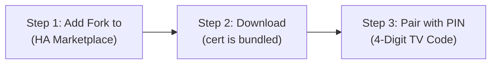

# 🔰 Beginner's Quick Start Guide: Set Up in Under 3 Minutes

Welcome! This guide is designed for **first-time users and beginners**. It skips the complex technical jargon and OpenSSL commands so you can get your smart TV running in Home Assistant as quickly and easily as possible.

> [!NOTE]
> ### 📺 Works With ALL VIDAA OS Brands
> Whether your TV or smart projector is badged as **Hisense, Toshiba, Loewe, Philips, Sharp, JVC, or TOPTRO**, if it runs **VIDAA OS**, this exact same setup works for you! All VIDAA devices share the exact same internal broker architecture and use the exact same certificate file.

---

## 🎯 What You Will Need

1. **A computer with a web browser** (Windows, Mac, or Linux).
2. **Your TV turned on and connected to the same Wi-Fi / home network** as Home Assistant.

> [!IMPORTANT]
> **No APK download, no file uploads, no Android device needed!**  
> This fork ships the universal VIDAA client certificate *inside the integration package* (`custom_components/vidaa/certs/`), so the manual `client_mobile_android.p12` extraction and `/config/ssl/` placement steps of the original upstream guide are not required.

---

## 🚀 3 Simple Steps

---

### Step 1: Add This Fork to the Home Assistant Marketplace

1. In Home Assistant, go to **Settings → Devices & Services**.
2. Open **Marketplace**, click the **⋮ (three-dot) menu** in the top right, and choose **Add custom repository**.
3. Enter:
   - **Repository URL:** `https://github.com/T4cC0re/vidaa`
   - **Category:** Integration
   - **Branch/channel:** `main`
4. Click **Add**.

> [!NOTE]
> **No manual certificate step.** The universal VIDAA client certificate (`hisense.crt`/`hisense.key`, plus the `client_mobile_android.p12`/`El.p12` keystore fallbacks and the `remote_ca.pem` root) is bundled inside the integration package and is auto-discovered at runtime. If you prefer your own keypair, you can still drop files into `/config/ssl/` — files there take priority over the bundled ones. See the [Advanced SSL Guide](certificates.md).

---

### Step 2: Download & Restart

1. Open the **VIDAA Smart TV (T4cC0re fork)** entry in the Marketplace and click **Download**.
2. Restart Home Assistant if prompted (**Settings → System → Restart**) — fresh integration code loads on restart.

*Home Assistant automatically uses the bundled certificates from the package—no passwords or conversion commands needed!*

---

### Step 3: Add the Integration & Enter Your Screen PIN

1. **Add the Integration**:
   - Go to **Settings → Devices & Services**.
   - Click the blue **Add Integration** button in the bottom right corner.
   - Search for **VIDAA Smart TV** and click it.
2. **Connect to Your TV**:
   - Enter your TV's IP address (e.g. `192.168.1.50`).
   - On the certificate step, just confirm the pre-filled defaults — they point at the bundled certificate pair.
   - Click **Submit**.
3. **Enter the 4-Digit PIN**:
   - Look at your TV screen—a **4-digit PIN code** will appear!
   - Type that 4-digit code into the prompt in Home Assistant.
   - Click **Submit**.

> [!TIP]
> **4-Digit PIN Not Appearing on Your TV Screen?**  
> Check your TV settings to ensure **Smart / Connected Services** are accepted (`Settings → Support / System → Terms & Conditions / Smart Services`). VIDAA OS suppresses the on-screen pairing PIN popup if connected services are disabled.  
> *(Privacy Note: It is completely safe to block the TV from internet/WAN access at your router once pairing is finished—Home Assistant local control works 100% offline).*

🎉 **You're all done!** Your TV will appear in Home Assistant with full media controls, volume slider, input source selector, remote navigation, and app launcher.

---

## 💡 Quick Tips for the Best Experience

1. **Turn on "Wake on LAN" in TV Settings**:
   - On your TV remote, open **Settings → Network → Network Management** (or *Advanced Settings*).
   - Turn **Wake on LAN (WoL)** and **Wake on Wi-Fi** to **ON**.
   - This ensures Home Assistant can still turn the TV back on when it is in standby.
2. **Close the Phone App When Pairing**:
   - The TV's internal broker only allows one pairing handshake at a time. If you have the VIDAA mobile app open on your phone, close it before pairing in Home Assistant.
3. **Brand-Specific Names & Auto-Detection**:
   - Home Assistant automatically auto-detects whether your TV or projector is Hisense, Toshiba, Loewe, Philips, Sharp, JVC, TOPTRO, etc., directly from UPnP network descriptors (`<modelDescription>`). If you prefer using certificate filenames, you can rename `El.p12` to `toshiba.p12`, `loewe.p12`, `toptro.p12`, etc., and Home Assistant will pick up the hint automatically!

---

## 🆘 Need More Help?

- ⚙️ **Want to customize buttons, sleep timers, and picture modes?** See [Configuration Parameters](parameters.md).
- 📱 **Want a beautiful virtual TV remote card on your dashboard?** See [Lovelace Remote Cards](lovelace_cards.md).
- 🎬 **Want to dim your living room lights when movies play?** See [Services & Automations](services_and_automations.md).
- 🔒 **Are you a network admin needing manual PEM keys or Root CA validation?** See [Advanced SSL Certificate Setup](certificates.md).
- 🩺 **Having trouble connecting?** See the [Troubleshooting Reference](troubleshooting.md).
